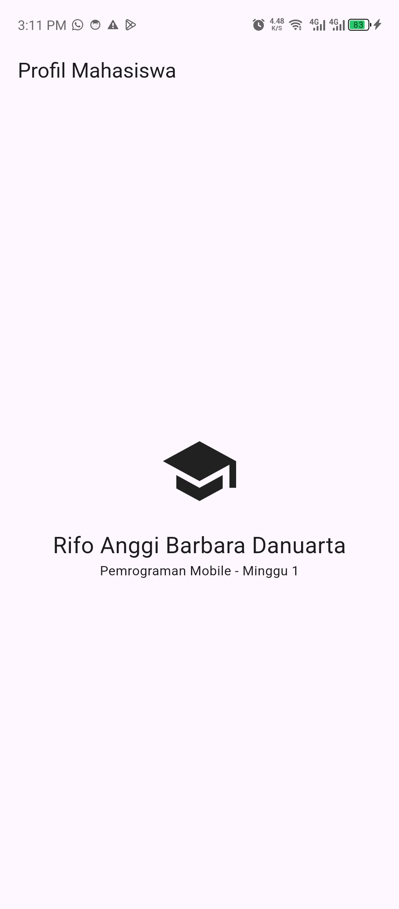
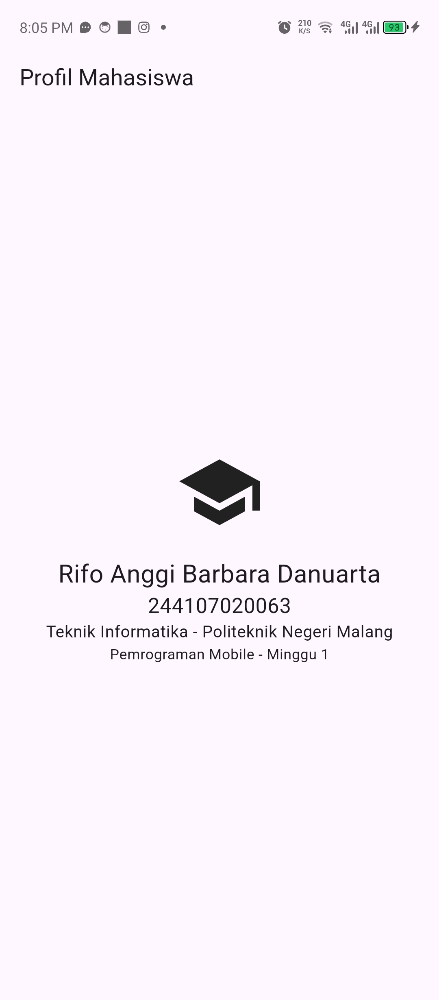

# Week 1 — Mobile Development Ecosystem & Flutter Refresh

## Identitas Mahasiswa

| Keterangan | Data |
|------------|------|
| **Nama**   | Rifo Anggi Barbara Danuarta |
| **NIM**    | 244107020063 |
| **Kelas**  | TI-3F |
---

# 1. Tujuan Pembelajaran

Setelah menyelesaikan praktikum Minggu 1, mahasiswa diharapkan mampu:

* Menjelaskan evolusi pengembangan aplikasi mobile.
* Menjelaskan perbedaan Native, Hybrid, dan Cross-platform.
* Menjelaskan arsitektur Flutter dan peran bahasa Dart.
* Memahami struktur project Flutter.
* Memahami konsep Widget Tree.
* Mengulang dasar bahasa Dart seperti variabel, tipe data, fungsi, class, dan Null Safety.
* Menyiapkan Flutter SDK, Android SDK, emulator atau perangkat Android.
* Membuat dan menjalankan aplikasi Flutter pertama.
* Memodifikasi tampilan UI aplikasi Flutter.
* Menggunakan Hot Reload dan Hot Restart.
* Menyimpan hasil project menggunakan Git dan GitHub.

---

# 2. Persiapan

Perangkat dan software yang diperlukan:

* Laptop/PC
* Koneksi internet
* Akun GitHub atau GitLab
* Git
* Visual Studio Code
* Extension Flutter dan Dart
* Flutter SDK
* Android Studio
* Android SDK
* Android Emulator atau perangkat Android fisik

Jika menggunakan perangkat Android fisik, USB Debugging harus diaktifkan.

---

# 3. Evolusi Pengembangan Mobile

Pengembangan aplikasi mobile mengalami perkembangan dari pendekatan Native menuju Hybrid dan Cross-platform.

## 3.1 Native

Native adalah pendekatan pengembangan aplikasi menggunakan teknologi khusus untuk setiap platform.

Contohnya:

* Android → Kotlin/Java
* iOS → Swift/Objective-C

Keunggulan Native adalah akses terhadap API perangkat yang lebih langsung dan performa yang optimal.

## 3.2 Hybrid

Hybrid menggunakan teknologi web yang dijalankan melalui pembungkus aplikasi native.

Contoh:

* Ionic
* Cordova

## 3.3 Cross-platform

Cross-platform memungkinkan developer menggunakan satu basis kode untuk menghasilkan aplikasi pada beberapa platform.

Contoh:

* Flutter
* React Native

### Perbandingan

| Pendekatan     | Ciri Utama                              | Contoh                |
| -------------- | --------------------------------------- | --------------------- |
| Native         | Kode dan UI khusus setiap platform      | Kotlin, Swift         |
| Hybrid         | Aplikasi web dalam pembungkus native    | Ionic, Cordova        |
| Cross-platform | Satu basis kode untuk beberapa platform | Flutter, React Native |

Pemilihan teknologi bergantung pada kebutuhan aplikasi, performa, akses fitur perangkat, kemampuan tim, biaya, dan target platform. Cross-platform tidak selalu menggantikan Native karena keduanya memiliki kelebihan dan kekurangan masing-masing.

---

# 4. Arsitektur Flutter dan Dart

Flutter menggunakan **Dart** sebagai bahasa pemrograman untuk membuat UI dan logika aplikasi.

Secara umum arsitektur Flutter terdiri dari:

```text
Flutter
│
├── Framework
│   ├── Widget
│   └── API
│
├── Engine
│   ├── Rendering
│   ├── Text
│   └── Graphics
│
└── Embedder
    ├── Android
    ├── iOS
    ├── Web
    └── Desktop
```

### Framework

Framework menyediakan widget dan API yang digunakan developer untuk membangun aplikasi.

### Engine

Engine menangani proses seperti rendering, teks, dan grafis.

### Embedder

Embedder menghubungkan aplikasi Flutter dengan platform target seperti Android, iOS, Web, dan Desktop.

Dart juga mendukung:

* **JIT (Just-In-Time)** untuk proses pengembangan.
* **AOT (Ahead-Of-Time)** untuk proses build aplikasi release.

---

# 5. Widget Tree

Flutter menggunakan pendekatan **declarative UI**, yaitu tampilan aplikasi menggambarkan kondisi atau state aplikasi saat ini.

Semua komponen UI dalam Flutter berupa widget yang disusun dalam struktur pohon atau **Widget Tree**.

Contoh:

```text
MaterialApp
└── Scaffold
    ├── AppBar
    │   └── Text
    │
    └── Body
        └── Column
            ├── Icon
            ├── SizedBox
            └── Text
```

Contoh sederhana:

```dart
MaterialApp
    ↓
Scaffold
    ↓
Column
    ├── Icon
    ├── SizedBox
    └── Text
```

Konsep Widget Tree menjadi dasar dalam pembuatan tampilan aplikasi Flutter.

---

# 6. Struktur Project Flutter

Struktur project Flutter secara umum:

```text
my_first_app/
├── android/
├── ios/
├── lib/
│   └── main.dart
├── test/
├── web/
├── pubspec.yaml
└── ...
```

### `lib/`

Berisi source code aplikasi.

File utama secara default adalah:

```text
lib/main.dart
```

### `test/`

Digunakan untuk menyimpan unit test dan widget test.

### `android/`

Berisi konfigurasi khusus platform Android.

### `ios/`

Berisi konfigurasi khusus platform iOS.

### `web/`

Berisi konfigurasi untuk target Web.

### `pubspec.yaml`

Berisi informasi project seperti:

* Metadata
* Dependency
* Asset
* Versi SDK

---

# 7. Hot Reload dan Hot Restart

Flutter menyediakan fitur Hot Reload dan Hot Restart untuk mempercepat proses pengembangan.

## 7.1 Hot Reload

Hot Reload memasukkan perubahan kode ke aplikasi tanpa biasanya menghapus state yang sedang berjalan.

Hot Reload cocok digunakan ketika melakukan perubahan UI.

Pada terminal Flutter:

```text
r
```

Alur penggunaannya:

```text
Edit kode
    ↓
Save
    ↓
Hot Reload
    ↓
Perubahan UI
```

## 7.2 Hot Restart

Hot Restart menjalankan ulang aplikasi dari awal sehingga state aplikasi akan hilang.

Pada terminal:

```text
R
```

Hot Restart digunakan ketika perubahan tidak dapat diterapkan menggunakan Hot Reload, misalnya perubahan pada proses inisialisasi aplikasi.

### Perbandingan

| Hot Reload                               | Hot Restart                |
| ---------------------------------------- | -------------------------- |
| Mempertahankan state pada umumnya        | State dihapus              |
| Lebih cepat                              | Lebih lambat               |
| Cocok untuk perubahan UI                 | Menjalankan ulang aplikasi |
| Tidak menjalankan ulang seluruh aplikasi | Aplikasi dimulai dari awal |

---

# 8. Dasar Bahasa Dart

Dart merupakan bahasa pemrograman bertipe statis dan mendukung **type inference**.

Beberapa konsep dasar yang digunakan:

* Variabel
* Tipe data
* Fungsi
* Class
* Constructor
* `final`
* Parameter `required`

Contoh:

```dart
void main() {
  String nama = 'Alya';
  int semester = 3;
  final bool aktif = true;

  print(sapa(nama, semester));

  final mahasiswa = Mahasiswa(
    nama: nama,
    aktif: aktif,
  );

  print(mahasiswa.status());
}

String sapa(String nama, int semester) {
  return 'Halo $nama, semester $semester';
}

class Mahasiswa {
  Mahasiswa({
    required this.nama,
    required this.aktif,
  });

  final String nama;
  final bool aktif;

  String status() {
    return aktif ? '$nama aktif' : '$nama tidak aktif';
  }
}
```

Pada contoh tersebut terdapat penggunaan variabel, tipe data, fungsi, class, constructor, `final`, dan parameter `required`.

---

# 9. Null Safety

Dart memiliki fitur **Null Safety** untuk membantu mencegah kesalahan akibat nilai `null`.

Secara default, sebuah variabel tidak dapat memiliki nilai `null`.

Jika sebuah variabel diperbolehkan memiliki nilai `null`, digunakan tanda `?`.

Contoh:

```dart
String? namaPanggilan;
```

Untuk menggunakan nilai tersebut dengan aman:

```dart
print(
  namaPanggilan?.toUpperCase() ?? 'BELUM DIISI',
);
```

Keterangan:

* `String?` → nilai dapat berupa `null`.
* `?.` → melakukan akses secara aman.
* `??` → memberikan nilai alternatif jika nilai sebelumnya `null`.

Penggunaan operator `!` sebaiknya hanya dilakukan jika sudah dapat dipastikan bahwa nilai tersebut tidak `null`.

---

# 10. Latihan Mandiri Dart

Materi menyediakan latihan dasar Dart yang dikerjakan secara mandiri.


---

# 11. Instalasi dan Verifikasi Flutter

## 11.1 Mengecek Git

Setelah Git di-install:

```bash
git --version
```

## 11.2 Mengecek Flutter

Setelah Flutter SDK berhasil di-install:

```bash
flutter --version
```

## 11.3 Menjalankan Flutter Doctor

```bash
flutter doctor
```

Perintah tersebut digunakan untuk memeriksa konfigurasi Flutter dan komponen pendukungnya.

## 11.4 Android License

Untuk menyetujui Android SDK License:

```bash
flutter doctor --android-licenses
```

Setelah menyelesaikan masalah yang ditemukan, jalankan kembali:

```bash
flutter doctor
```

hingga tidak terdapat masalah yang menghambat target Android.

---

# 12. Target Perangkat

Flutter dapat dijalankan menggunakan:

1. Android Emulator
2. Perangkat Android fisik

## Android Emulator

Emulator dibuat dan dijalankan melalui:

```text
Android Studio
    ↓
Device Manager
    ↓
Create Virtual Device
    ↓
Run
```

## Android Fisik

Jika menggunakan perangkat Android fisik:

1. Aktifkan Developer Options.
2. Aktifkan USB Debugging.
3. Hubungkan perangkat menggunakan kabel data.
4. Izinkan komputer ketika muncul permintaan otorisasi.

Kemudian cek perangkat:

```bash
flutter devices
```

Perintah tersebut harus menampilkan minimal satu target perangkat.

---

# 13. Membuat Project Flutter

Project Flutter dibuat menggunakan perintah:

```bash
flutter create my_first_app
```

Masuk ke project:

```bash
cd my_first_app
```

Kemudian jalankan:

```bash
flutter run
```

Pilih emulator atau perangkat fisik jika diminta.

Setelah aplikasi berjalan, Hot Reload dapat digunakan dengan:

```text
r
```

dan Hot Restart dengan:

```text
R
```

---

# 14. Mengubah UI Default Flutter

File utama aplikasi berada pada:

```text
lib/main.dart
```

Kode UI dari praktikum:

```dart
import 'package:flutter/material.dart';

void main() => runApp(const MyApp());

class MyApp extends StatelessWidget {
  const MyApp({super.key});

  @override
  Widget build(BuildContext context) {
    return MaterialApp(
      debugShowCheckedModeBanner: false,
      home: Scaffold(
        appBar: AppBar(
          title: const Text('Profil Mahasiswa'),
        ),
        body: const Center(
          child: Column(
            mainAxisSize: MainAxisSize.min,
            children: [
              Icon(
                Icons.school,
                size: 72,
              ),
              SizedBox(height: 16),
              Text(
                'Nama Anda',
                style: TextStyle(
                  fontSize: 24,
                ),
              ),
              Text(
                'Pemrograman Mobile — Minggu 1',
              ),
            ],
          ),
        ),
      ),
    );
  }
}
```

Bagian:

```dart
'Nama Anda'
```

diganti dengan nama mahasiswa masing-masing.

Kemudian dilakukan perubahan pada ikon atau teks untuk membandingkan hasil **Hot Reload** dan **Hot Restart**.

---

# 15. Widget yang Digunakan

Pada aplikasi Profil Mahasiswa digunakan beberapa widget dasar:

| Widget        | Fungsi                           |
| ------------- | -------------------------------- |
| `MaterialApp` | Root aplikasi Material           |
| `Scaffold`    | Struktur dasar halaman           |
| `AppBar`      | Menampilkan bagian atas aplikasi |
| `Center`      | Menempatkan widget di tengah     |
| `Column`      | Menyusun widget secara vertikal  |
| `Icon`        | Menampilkan ikon                 |
| `SizedBox`    | Memberikan jarak                 |
| `Text`        | Menampilkan teks                 |

Struktur Widget Tree aplikasi:

```text
MaterialApp
└── Scaffold
    ├── AppBar
    │   └── Text
    │
    └── Center
        └── Column
            ├── Icon
            ├── SizedBox
            ├── Text
            └── Text
```

---

# 16. Struktur Repository Portfolio

Repository portfolio digunakan untuk mendokumentasikan project selama 16 minggu.

Struktur utama:

```text
nim-mobile-course/
├── README.md
│
├── 01-week-1-mobile-development-ecosystem-flutter-refresh/
│   ├── README.md
│   ├── lib/
│   ├── test/
│   └── screenshots/
│
├── 02-week-2-declarative-ui-responsive-design/
│   ├── README.md
│   ├── lib/
│   ├── test/
│   └── screenshots/
│
├── 03-week-3-navigation-state-management/
│   ├── README.md
│   ├── lib/
│   ├── test/
│   └── screenshots/
│
├── ...
│
├── 16-week-16-final-project-expo/
│   ├── README.md
│   ├── lib/
│   ├── docs/
│   ├── screenshots/
│   └── demo-video/
│
├── notes/
│   ├── reflections/
│   ├── learning-journal/
│   └── resources/
│
└── portfolio-summary.md
```

Untuk Minggu 1, aplikasi ditempatkan pada:

```text
01-week-1-mobile-development-ecosystem-flutter-refresh/
```

Folder Minggu 1 terdiri dari:

```text
01-week-1-mobile-development-ecosystem-flutter-refresh/
├── README.md
├── lib/
├── test/
└── screenshots/
```

Folder `screenshots/` digunakan sebagai dokumentasi visual hasil praktikum.

---
# 17. Hasil Praktikum

---

## 17.1 Aplikasi Profil Mahasiswa

Aplikasi berhasil dijalankan pada emulator/perangkat Android.



Contoh:

```text
screenshots/
└── profile-mahasiswa.png
```
---

# 18. Mini Assignment

Mini assignment Minggu 1 adalah membuat aplikasi **Profil Mahasiswa** berdasarkan praktikum.



Struktur hasil:

```text
01-week-1-mobile-development-ecosystem-flutter-refresh/
├── README.md
├── lib/
│   └── main.dart
├── test/
└── screenshots/
    ├── flutter-doctor.png
    ├── flutter-devices.png
    ├── profile-mahasiswa.png
    ├── hot-reload.png
    ├── hot-restart.png
    └── github-repository.png
```

---

# 19. Kendala Setup

Selama proses setup Flutter, beberapa kendala yang dapat ditemukan antara lain:

* Flutter SDK belum masuk ke PATH.
* Android SDK belum terkonfigurasi.
* Android License belum disetujui.
* Emulator belum terdeteksi.
* USB Debugging belum aktif.
* Driver USB belum terpasang.
* Terdapat masalah pada konfigurasi Android Studio.
* Project gagal melakukan build karena terdapat kesalahan kode.

Kendala yang ditemukan pada praktikum:

> **Tuliskan kendala yang benar-benar kamu alami di sini.**

Contoh format:

```text
Kendala:
Emulator Android belum terdeteksi oleh Flutter.

Solusi:
Melakukan pengecekan menggunakan flutter devices,
kemudian memastikan emulator telah berjalan dan Android SDK
telah dikonfigurasi dengan benar.
```

---

# 20. Refleksi

## 20.1 Kapan Native lebih tepat dipilih daripada Cross-platform?

Native lebih tepat dipilih ketika aplikasi membutuhkan performa maksimal, akses yang sangat spesifik terhadap API perangkat, atau membutuhkan fitur platform tertentu yang lebih mudah diimplementasikan secara native.

Cross-platform lebih sesuai ketika ingin mengembangkan aplikasi untuk beberapa platform dengan satu basis kode.

---

## 20.2 Bagaimana perubahan state berhubungan dengan Widget Tree dan UI deklaratif?

Flutter menggunakan pendekatan declarative UI. Tampilan aplikasi menggambarkan kondisi atau state aplikasi saat ini.

Ketika state berubah, Flutter dapat membangun kembali bagian Widget Tree yang diperlukan sehingga tampilan dapat menyesuaikan dengan kondisi terbaru.

---

## 20.3 Mengapa commit kecil dengan pesan jelas bermanfaat?

Commit kecil dengan pesan yang jelas membuat perubahan kode lebih mudah dilacak dan dipahami.

Hal ini juga bermanfaat ketika:

* Melakukan debugging.
* Mengembalikan perubahan.
* Bekerja dalam tim.
* Melihat perkembangan project.
* Menjadikan repository sebagai portfolio.

---

