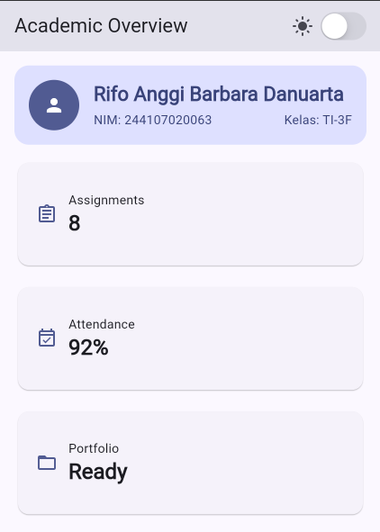
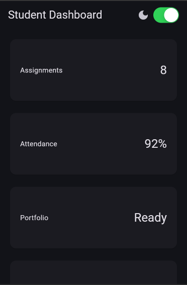
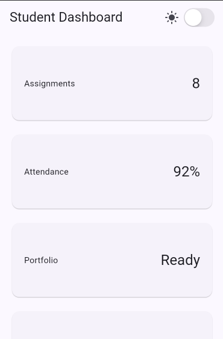
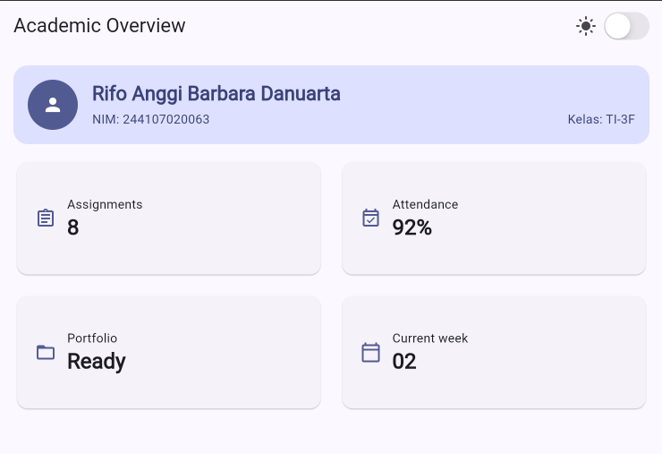
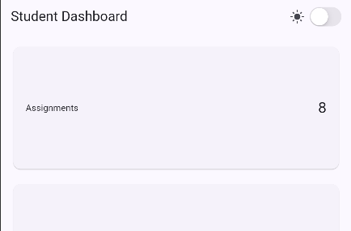
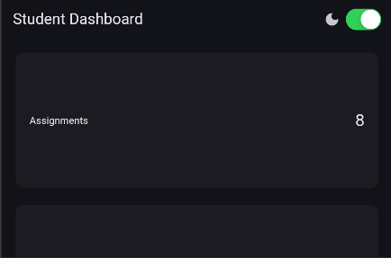

# Week 2 — declarative ui responsive design

## Identitas Mahasiswa

| Keterangan | Data |
|------------|------|
| **Nama**   | Rifo Anggi Barbara Danuarta |
| **NIM**    | 244107020063 |
| **Kelas**  | TI-3F |
---

## Screenshot Hasil

****

**Layar sempit (1 kolom)**

**Layar lebar (2 kolom)**

## Refleksi

**1. Apa perbedaan cara berpikir imperative dan declarative saat membangun UI?**

Pada cara imperative, kita menulis instruksi langkah demi langkah untuk
mengubah tampilan yang sudah ada (misal: cari elemen teks, lalu ubah
isinya secara manual). Pada cara declarative seperti di Flutter, kita
cukup mendeskripsikan tampilan seharusnya seperti apa berdasarkan state
saat ini lewat method `build()`. Ketika state berubah (misal `isDark`
berubah lewat `setState`), kita tidak menyentuh widget satu per satu —
Flutter yang membangun ulang bagian UI yang relevan. Fokus developer
jadi ke hubungan data-ke-tampilan, bukan ke urutan manipulasi elemen.

**2. Kapan `Expanded` membantu dan kapan penggunaannya justru menghasilkan layout error?**

`Expanded` membantu ketika ada child di dalam `Row`/`Column` yang perlu
mengisi sisa ruang yang tersedia secara proporsional, misalnya teks nama
mahasiswa di header profil agar tidak overflow ketika namanya panjang.
Namun `Expanded` akan error jika dipakai di luar konteks `Row`/`Column`
(parent-nya bukan flex widget), atau jika parent-nya sendiri tidak
memiliki batas ukuran yang jelas (misal `Expanded` di dalam
`SingleChildScrollView`/`ListView` dengan arah scroll yang sama — ini
menyebabkan "RenderBox was not laid out" karena `Expanded` butuh
constraint tinggi/lebar terbatas untuk membagi ruang, sedangkan area
scroll dianggap tak terbatas ke arah scroll-nya).

**3. Bagaimana breakpoint dan theme memengaruhi pengalaman pengguna?**

Breakpoint (`kWideBreakpoint = 700`) menentukan kapan tata letak berubah
dari satu kolom ke dua kolom. Tanpa breakpoint yang tepat, tampilan di
tablet akan terasa kosong dan tidak memanfaatkan ruang, sedangkan di
ponsel kartu bisa jadi terlalu sempit kalau dipaksa dua kolom. Theme
(light/dark) memengaruhi kenyamanan baca sesuai kondisi pencahayaan dan
preferensi pengguna, serta memastikan kontras warna tetap cukup di kedua
mode — bukan sekadar membalik warna hitam-putih. Karena warna diambil
dari `Theme.of(context)`, semua komponen otomatis konsisten saat tema
berganti, tanpa perlu mengubah kode di banyak tempat.

**4. Apa yang Anda verifikasi dari rekomendasi AI setelah tugas inti selesai?**

Setelah membandingkan versi `GridView` dan versi `LayoutBuilder` +
`Column` dari AI, saya menjalankan ulang kedua versi secara manual pada
lebar layar di bawah 600px untuk memastikan keduanya tetap menampilkan
satu kolom dan tidak overflow. Saya juga mengecek bahwa label
`Semantics` yang disarankan AI tetap masuk akal saat dibacakan (tidak
menghilangkan informasi penting), dan memastikan semua widget yang
dipakai (`GridView.count`, `LayoutBuilder`, `CupertinoSwitch`) memang
tersedia di Flutter stable channel saat ini, bukan API eksperimental
atau sudah deprecated.
