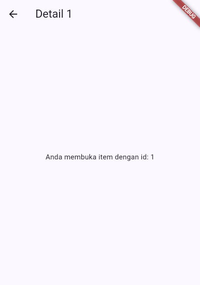
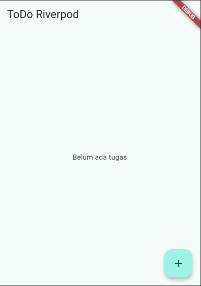
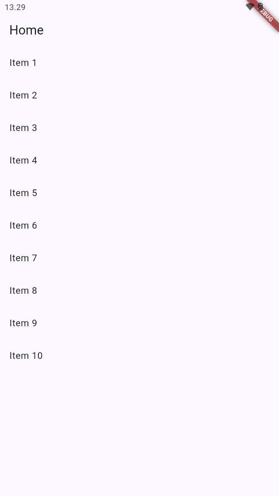
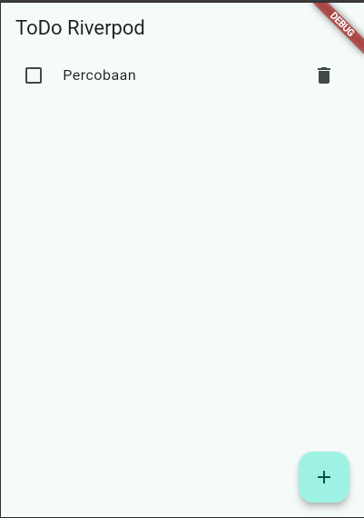

# Week 3 - Navigation & State Management

## Identitas Mahasiswa

| Keterangan | Data |
|---|---|
| Nama | Rifo Anggi Barbara Danuarta |
| NIM | 244107020063 |
| Kelas | TI-3F |

## Project

### `week3_navigation`

Project navigasi Flutter menggunakan GoRouter. Fitur utamanya adalah halaman home, halaman detail, dan pengiriman parameter `id` melalui route `/detail/:id`.

### `week3_todo`

Project state management menggunakan Riverpod `Notifier`. Fitur utamanya adalah menambah todo, menandai todo selesai, dan menghapus todo.

## Struktur

```text
03-week-3-navigation-state-management/
├── README.md
├── screenshots/
├── week3_navigation/
│   ├── lib/main.dart
│   └── lib/pages/
└── week3_todo/
    ├── lib/main.dart
    └── lib/providers/
```

## Menjalankan

```powershell
cd week3_navigation
flutter pub get
flutter analyze
flutter test
flutter run
```

Untuk project todo, masuk ke folder `week3_todo` dan jalankan perintah yang sama.

## Screenshot






## Refleksi

- GoRouter memisahkan definisi route dari widget dan mendukung parameter dinamis.
- Riverpod membuat state todo terpusat dan perubahan state memicu rebuild UI secara deklaratif.
- `Notifier` sesuai untuk state yang memiliki operasi tambah, ubah, dan hapus.
- State management menghindari pemindahan data manual antar-widget yang semakin sulit dirawat.

## Verifikasi

Jalankan `flutter analyze` dan `flutter test` dari masing-masing folder project. Screenshot pada folder ini merupakan bukti visual navigasi dan state management.
