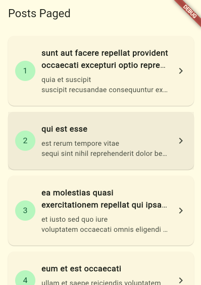
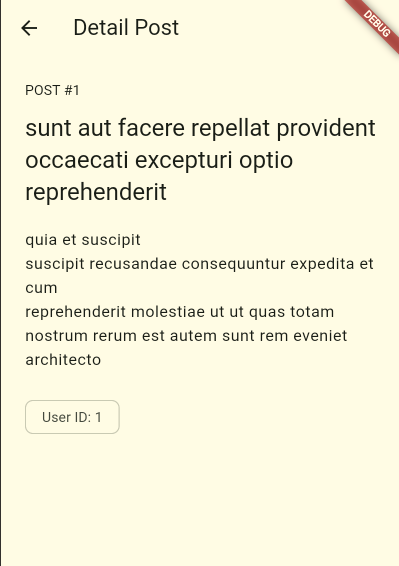

# Week 4 - Networking & REST API

## Identitas Mahasiswa

| Keterangan | Data |
|---|---|
| Nama | Rifo Anggi Barbara Danuarta |
| NIM | 244107020063 |
| Kelas | TI-3F |

## Project

`week4_api` mengambil data posts dari JSONPlaceholder menggunakan Dio, Riverpod, repository pattern, dan GoRouter.

## Fitur

- Model `Post` dengan parsing JSON aman null.
- Dio terpusat dengan base URL dan timeout.
- Repository sebagai pintu akses API.
- Loading, error, empty, success, retry, dan pull-to-refresh.
- Pagination infinite scroll.
- Detail post melalui `/post/:id`.
- Test provider menggunakan fake repository tanpa internet.

## Struktur

```text
04-week-4-networking-rest-api/
├── README.md
├── screenshots/
└── week4_api/
    ├── lib/
    ├── test/
    ├── docs/
    └── pubspec.yaml
```

## Menjalankan

```powershell
cd week4_api
flutter pub get
flutter analyze
flutter test
flutter run
```

## Arsitektur

```text
UI -> Riverpod -> PostRepository -> Dio -> REST API
```

UI tidak memanggil Dio langsung. Exception jaringan dipetakan menjadi pesan yang dapat dipahami pengguna.

## Screenshot





## Refleksi

### 1. Mengapa UI tidak boleh memanggil Dio secara langsung?

UI seharusnya hanya bertanggung jawab menampilkan state. Jika widget memanggil Dio langsung, logika HTTP, parsing JSON, error handling, dan tampilan akan tercampur. Akibatnya widget sulit diuji, konfigurasi API tersebar, dan perubahan endpoint dapat memengaruhi banyak halaman. Repository menjadi satu pintu data sehingga provider dan UI tetap sederhana serta mudah diganti dengan fake repository saat testing.

### 2. Kapan pagination client-side dan server-side digunakan?

Pagination client-side cukup jika jumlah data kecil dan seluruh data memang aman diunduh sekaligus. Pagination server-side lebih tepat untuk data besar karena server hanya mengirim halaman yang dibutuhkan, mengurangi bandwidth, waktu tunggu, dan penggunaan memori. Project ini menggunakan query `?_page=N&_limit=10` dari JSONPlaceholder dan guard `isLoadingMore` agar scroll tidak membuat request ganda.

### 3. Bagaimana exception repository menjadi `AsyncError`?

Repository membiarkan exception Dio naik, bukan menelannya dengan `catch` kosong. `AsyncNotifier.build()` mengembalikan Future, sehingga Riverpod menangkap kegagalan Future dan mengubahnya menjadi `AsyncError`. UI kemudian menggunakan `when(loading:, error:, data:)` untuk menampilkan loading, pesan error yang ramah, retry, atau data berhasil. `try/catch` eksplisit tetap diperlukan untuk operasi mutasi seperti refresh ketika aplikasi perlu mengatur state secara manual.

### 4. Apa yang diverifikasi dari hasil AI?

Saya memastikan UI tidak memanggil Dio langsung, `fromJson` memakai cast defensif, timeout dan base URL terpusat, serta tipe error jaringan dipetakan ke pesan pengguna. Test provider menggunakan fake repository sehingga tidak melakukan HTTP sungguhan. Edge case field JSON yang hilang juga diuji agar parsing tidak crash.
