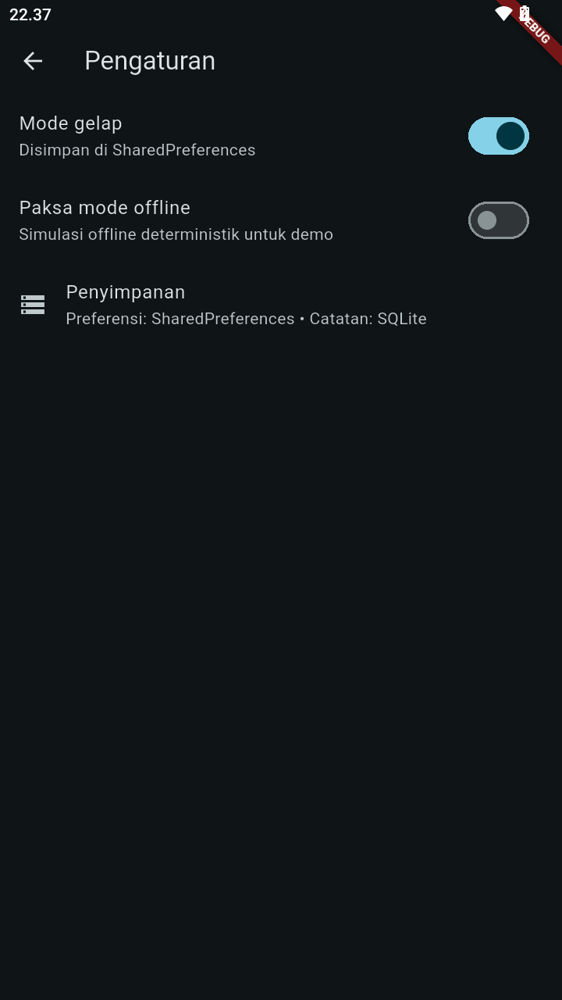
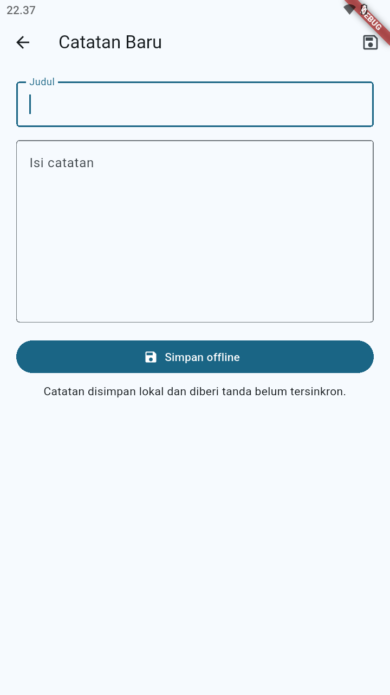

# Week 5 - Local Storage & Offline First

## Identitas Mahasiswa

| Keterangan | Data |
|---|---|
| Nama | Rifo Anggi Barbara Danuarta |
| NIM | 244107020063 |
| Kelas | TI-3F |

## Project

`week5_offline_notes` adalah aplikasi catatan offline-first.

## Fitur

- CRUD catatan menggunakan SQLite.
- Preferensi tema dan mode offline menggunakan SharedPreferences.
- Dirty flag untuk catatan belum tersinkron.
- Sinkronisasi dengan simulasi server.
- Cache-first helper untuk data API.
- Detail dan edit catatan menggunakan GoRouter.
- Test model dan provider palsu tanpa database sungguhan.

## Pemilihan storage

| Kebutuhan | Teknologi | Alasan |
|---|---|---|
| Preferensi kecil | SharedPreferences | Sederhana untuk boolean/string |
| Catatan terstruktur | SQLite/sqflite | Mendukung query, sorting, dan dirty flag |
| Cache objek sederhana | Hive | Alternatif NoSQL ringan |
| Query type-safe reaktif | Drift | Cocok untuk aplikasi lebih besar |

## Struktur

```text
05-week-5-local-storage-offline-first/
├── README.md
├── screenshots/
└── week5_offline_notes/
    ├── lib/
    ├── test/
    ├── docs/
    └── pubspec.yaml
```

## Menjalankan

```powershell
cd week5_offline_notes
flutter pub get
flutter analyze
flutter test
flutter run
```

## Screenshot





## Refleksi

### 1. Mengapa daftar catatan tidak disimpan di SharedPreferences?

SharedPreferences cocok untuk nilai kecil dan primitif seperti boolean, string, atau angka. Jika daftar catatan disimpan sebagai satu JSON besar, query, sorting, update satu catatan, dan sinkronisasi menjadi rapuh serta tidak efisien. SQLite lebih tepat karena memiliki tabel, query, sorting berdasarkan `updated_at`, dan kolom `dirty`.

### 2. Kapan cache-first cukup dan kapan network-first lebih tepat?

Cache-first cocok untuk data yang tetap berguna walaupun tidak paling baru, seperti daftar catatan atau data bacaan yang dapat diperbarui di background. Network-first lebih tepat untuk data yang harus selalu terbaru, misalnya harga real-time atau status pembayaran. Project ini menampilkan data lokal terlebih dahulu agar UI tidak blank saat offline, lalu mencoba refresh jaringan di background.

### 3. Bagaimana dirty flag menjadi antrean sinkronisasi?

Setiap catatan yang dibuat atau diubah lokal diberi `dirty = 1`. Saat koneksi tersedia, repository mengambil catatan dirty secara berurutan, mensimulasikan upload, lalu mengubahnya menjadi `dirty = 0` hanya setelah proses berhasil. Untuk aplikasi yang lebih kompleks, antrean terpisah atau tabel outbox diperlukan agar operasi tambah, ubah, dan hapus dapat diproses ulang secara terurut tanpa kehilangan operasi.

### 4. Bagaimana konflik dua arah diselesaikan?

Project ini mendokumentasikan aturan last-write-wins berdasarkan `updated_at`. Data dengan waktu perubahan paling baru menjadi hasil final. Aturan harus eksplisit supaya sinkronisasi tidak menimpa perubahan pengguna secara diam-diam.

### 5. Apa yang diverifikasi dari rekomendasi AI?

Saya menolak menyimpan koleksi catatan di SharedPreferences dan memilih kombinasi SharedPreferences untuk preferensi kecil serta SQLite untuk notes. Saya juga memastikan skema memiliki `dirty` dan `updated_at`, repository dapat diinjeksi dengan database palsu, dan test tidak membuka database SQLite sungguhan.
