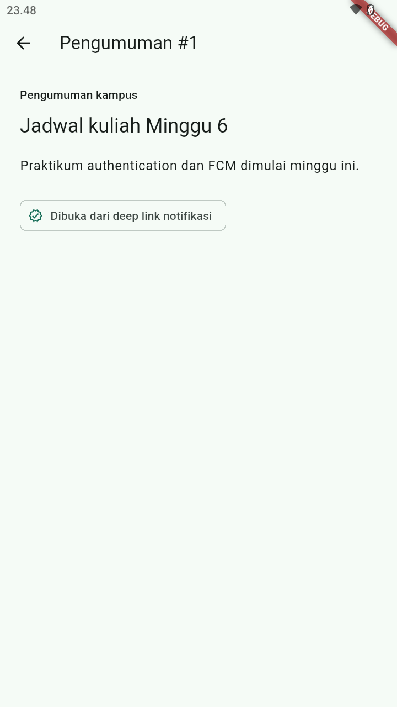

# Week 6 - Authentication, Security & FCM

## Identitas Mahasiswa

| Keterangan | Data |
|---|---|
| Nama | Rifo Anggi Barbara Danuarta |
| NIM | 244107020063 |
| Kelas | TI-3F |

## Project

`week6_campus_notify` mempraktikkan mock authentication, secure token storage, refresh token, route guard, deep link, dan service FCM.

## Fitur

- Login mock dengan validasi email dan password.
- Access/refresh token di `flutter_secure_storage`.
- Route guard `/login` dan `/`.
- Dio interceptor refresh satu kali saat 401.
- Logout ketika refresh gagal.
- Pengumuman dan detail `/pengumuman/:id`.
- Push service FCM-ready untuk foreground, background, terminated, token refresh, dan topic.
- Unit test parsing route dan logika sesi.

## Struktur

```text
06-week-6-authentication-security-fcm/
├── README.md
├── screenshots/
└── week6_campus_notify/
    ├── lib/
    ├── test/
    ├── docs/
    └── pubspec.yaml
```

## Menjalankan

```powershell
cd week6_campus_notify
flutter pub get
flutter analyze
flutter test
flutter run
```

Login demo:

```text
Email: mahasiswa@polinema.ac.id
Password: password
```

## Screenshot





Screenshot FCM tiga app state memerlukan konfigurasi Firebase nyata. Token FCM penuh tidak ditampilkan pada screenshot.

## Keamanan

- Token tidak disimpan di SharedPreferences.
- Refresh token tidak dikirim lewat URL.
- Token tidak dicetak penuh di log.
- FCM nyata memerlukan `google-services.json`, Firebase initialization, dan pengujian tiga app state.

## Refleksi

### 1. Mengapa refresh token harus disimpan di secure storage?

Refresh token memiliki masa hidup lebih panjang dan dapat digunakan untuk memperoleh access token baru. Jika bocor, penyerang dapat mempertahankan sesi tanpa login ulang. Karena itu refresh token disimpan melalui `flutter_secure_storage` yang memakai mekanisme aman platform, bukan SharedPreferences. Token juga tidak boleh dicetak penuh di log atau dikirim melalui query URL.

### 2. Apa dampak jika `onTokenRefresh` diabaikan?

Registration token FCM dapat berubah setelah reinstall, clear data, atau rotasi keamanan. Jika aplikasi tidak mengirim token baru ke backend, server menyimpan token basi dan notifikasi berhenti diterima pada perangkat tersebut. Karena itu lifecycle token harus mencakup `getToken()` dan listener `onTokenRefresh`.

### 3. Kapan memakai topic dan kapan memakai token perangkat?

Topic digunakan untuk broadcast seperti pengumuman seluruh kampus, satu kelas, atau satu UKM. Registration token perangkat digunakan untuk pesan personal seperti nilai, tagihan, atau informasi yang hanya boleh diterima satu pengguna. Data payload menyertakan `route` agar klik notifikasi dapat membuka detail pengumuman yang benar.

### 4. Apa yang diverifikasi dari hasil AI?

Saya memastikan background handler berupa fungsi top-level dengan `@pragma('vm:entry-point')`, foreground menggunakan local notification manual, dan route parser dipisahkan sebagai fungsi murni yang dapat diuji tanpa Firebase. Interceptor Dio membatasi refresh dan retry satu kali agar tidak terjadi loop. FCM tiga app state belum diklaim lulus karena membutuhkan `google-services.json`, Firebase initialization, dan pengujian dari Firebase Console.
