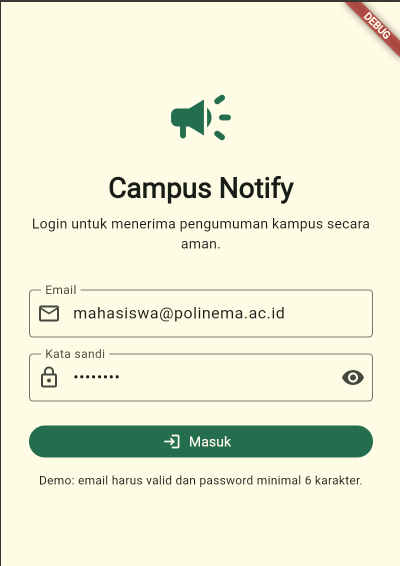
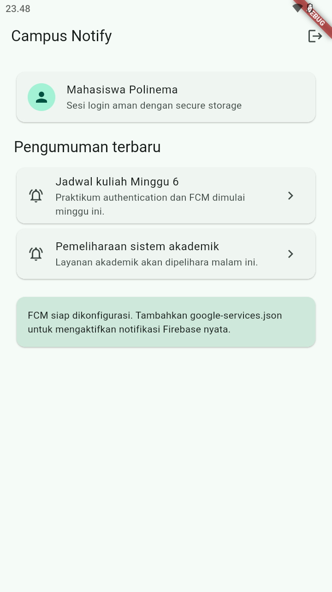
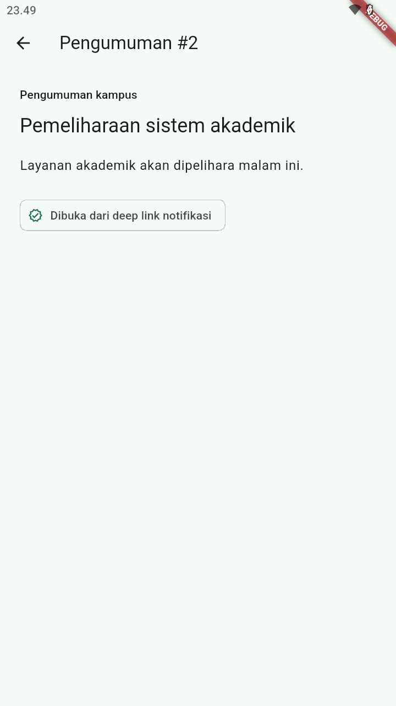
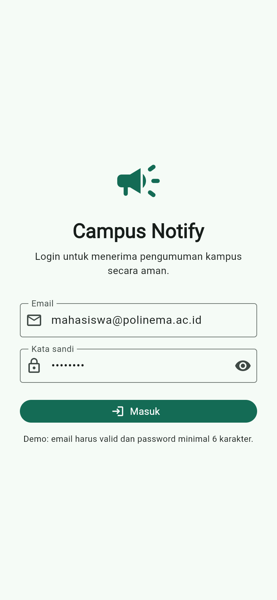
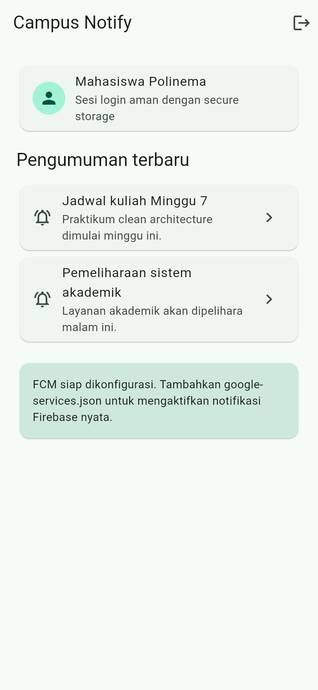
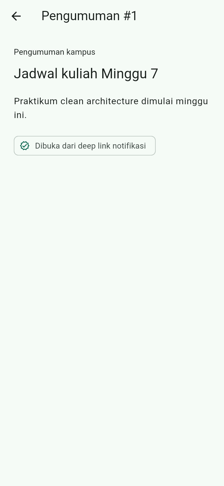

# Week 7 — Clean Architecture

Refactor project **Campus Notify** (Minggu 6) menjadi struktur **feature-first Clean
Architecture**. Fitur yang direfactor penuh: `auth` dan `announcements`.

## Identitas Mahasiswa

| Keterangan | Data |
|---|---|
| Nama | Rifo Anggi Barbara Danuarta |
| NIM | 244107020063 |
| Kelas | TI-3F |

## Tujuan

- Menjelaskan prinsip SOLID dan separation of concerns pada kode Flutter.
- Membedakan struktur feature-first dan layer-first.
- Menerapkan tiga layer (presentation, domain, data) dengan dependency rule.
- Membedakan entity dan model serta peran repository, use case, dan DI.
- Menguji use case dengan repository palsu tanpa database/jaringan sungguhan.

## Diagram layer dan arah dependensi

```text
presentation (widget, notifier, router)
      |
      v  bergantung ke
domain (entity, repository interface, use case)
      ^
      |  diimplementasikan oleh
data (model, repository impl, Dio, secure storage)

core       -> utilitas murni Dart (failure, route, format)
infrastructure -> kode yang bergantung plugin (FCM, local notification)
```

Aturan emas: dependensi hanya mengarah ke dalam. `domain` dan `core` tidak tahu apa pun
tentang Flutter, Dio, SQLite, atau Firebase.

## Struktur folder

```text
07-week-7-clean-architecture/
├── README.md
├── docs/
│   └── ai-challenge.md
├── screenshots/
│   ├── before/
│   └── after/
└── week7_campus_notify/
    ├── lib/
    │   ├── core/
    │   │   ├── failures.dart              # sealed Failure
    │   │   ├── format.dart                # routeFromMessage (fungsi murni)
    │   │   └── routes.dart                # AppRoutes
    │   ├── features/
    │   │   ├── auth/
    │   │   │   ├── domain/
    │   │   │   │   ├── entities/auth_session.dart
    │   │   │   │   ├── repositories/auth_repository.dart      # interface
    │   │   │   │   └── usecases/{login,logout,is_logged_in}.dart
    │   │   │   ├── data/
    │   │   │   │   ├── datasources/token_store.dart
    │   │   │   │   ├── api_client.dart
    │   │   │   │   └── repositories/auth_repository_impl.dart
    │   │   │   └── presentation/
    │   │   │       ├── providers/auth_providers.dart
    │   │   │       └── pages/login_page.dart
    │   │   └── announcements/
    │   │       ├── domain/
    │   │       │   ├── entities/announcement.dart
    │   │       │   ├── repositories/announcement_repository.dart
    │   │       │   └── usecases/{get_announcements,get_announcement}.dart
    │   │       ├── data/
    │   │       │   ├── models/announcement_model.dart
    │   │       │   └── repositories/announcement_repository_impl.dart
    │   │       └── presentation/
    │   │           ├── providers/announcement_providers.dart
    │   │           └── pages/{home_page,announcement_detail_page}.dart
    │   ├── infrastructure/
    │   │   ├── auth_refresh_notifier.dart
    │   │   └── messaging/push_service.dart
    │   ├── app.dart
    │   └── main.dart
    ├── test/
    └── pubspec.yaml
```

## Perubahan utama dari Week 6

| Week 6 | Week 7 |
|---|---|
| `data/auth_repository.dart` (interface + impl jadi satu) | Dipisah: interface di `domain`, impl di `data` |
| `providers/auth_provider.dart` bercampur wiring | `presentation/providers/auth_providers.dart` khusus DI |
| Data pengumuman hardcoded di widget | Diambil lewat repository + use case |
| Tidak ada `Failure` | `sealed Failure` dengan `AuthFailure`, `AnnouncementFailure` |
| Tidak ada use case | `Login`, `Logout`, `IsLoggedIn`, `GetAnnouncements`, `GetAnnouncement` |
| `routes.dart` menampung util + notifier | `core/` murni + `infrastructure/` untuk yang bergantung plugin |

## Fitur

- Login mock dengan validasi email dan password.
- Route guard GoRouter: belum login selalu ke `/login`.
- Access/refresh token di `flutter_secure_storage` lewat `TokenStore`.
- Dio interceptor refresh satu kali saat 401.
- Daftar pengumuman dari repository + use case (loading, error, empty, success).
- Detail pengumuman `/pengumuman/:id` dari repository.
- Push service FCM-ready di `infrastructure/messaging`.

## Stack teknologi

- Flutter 3.x (Dart 3.13)
- `flutter_riverpod` ^3 (DI + state)
- `go_router` ^18
- `dio` ^5
- `flutter_secure_storage` ^9
- `firebase_core`, `firebase_messaging`, `flutter_local_notifications`

## Verifikasi dependency rule

```text
# 1. Presentation steril dari data mentah -> 0 hasil
grep "Dio\(|openDatabase|getDatabasesPath|FlutterSecureStorage|SharedPreferences.getInstance|jsonDecode"
     lib/features/*/presentation

# 2. Domain & core steril dari framework -> 0 hasil
grep "import 'package:flutter|import 'package:dio|import 'package:sqflite|import 'package:firebase"
     lib/features/*/domain lib/core

# 3. Static analysis + test
flutter analyze  -> No issues found!
flutter test     -> 7 tests passed
```

## Testing

```bash
cd week7_campus_notify
flutter test
```

Hasil:

```text
login_usecase_test.dart        : 2 test (sukses + failure)
get_announcements_test.dart    : 2 test (sukses + failure)
route_from_message_test.dart   : 3 test
All tests passed!
```

## Screenshot

UI identik sebelum dan sesudah refactor; yang berubah adalah struktur layer.

**Sebelum refactor (Week 6)**






**Sesudah refactor (Week 7)**





## Cara menjalankan

```bash
cd week7_campus_notify
flutter pub get
flutter analyze
flutter test
flutter run
```

Login demo:

```text
Email: mahasiswa@polinema.ac.id
Password: password
```

## AI Verification Checklist

| Item | Status | Catatan |
|---|---|---|
| Interface di domain, impl di data | ✅ | `auth_repository.dart` vs `auth_repository_impl.dart` |
| Domain bebas import Flutter/Dio/SQLite/Firebase | ✅ | diverifikasi grep, 0 hasil |
| Use case tidak berlebihan | ✅ | hanya operasi bernilai bisnis |
| Entity bebas mapping | ✅ | mapping hanya di `AnnouncementModel` |
| DI terpusat di provider | ✅ | tidak ada `new Repository()` di widget |
| `flutter analyze` dan `flutter test` lolos | ✅ | bersih, 7 test lulus |

## Refleksi

### 1. Mengapa interface repository harus tinggal di domain?

Karena domain adalah pemilik aturan bisnis dan tidak boleh bergantung pada detail
implementasi. Jika interface diletakkan di data, domain harus mengimpor layer data,
sehingga arah dependensi terbalik dan logika bisnis ikut bergantung pada Dio/SQLite.
Dengan interface di domain, implementasi apa pun (mock, REST, lokal) bisa diganti tanpa
menyentuh domain, dan pengujian cukup memakai repository palsu.

### 2. Kapan use case benar-benar dibutuhkan?

Use case diperlukan ketika operasi menggabungkan lebih dari satu repository atau
memiliki aturan bisnis (validasi, sorting, sinkronisasi). Untuk CRUD satu baris tanpa
aturan tambahan, repository langsung ke notifier sudah cukup. Di project ini use case
dipakai untuk operasi bernilai bisnis (`Login`, `GetAnnouncements`), bukan membungkus
setiap pemanggilan repository tanpa alasan.

### 3. Apa biaya over-engineering bagi tim kecil?

Membuat use case untuk setiap CRUD satu-baris menambah jumlah file, lapisan pemetaan,
dan waktu navigasi kode tanpa manfaat langsung. Untuk tim kecil, ini memperlambat
perubahan dan menyulitkan onboarding. Biayanya sepadan saat aplikasi besar, banyak
aturan bisnis, atau banyak kontributor yang butuh batas jelas antar layer.

### 4. Bagian usulan AI yang ditolak atau disederhanakan?

Saya menolak penambahan package DI `get_it` karena Riverpod sudah menjadi container DI.
Saya juga memindahkan `PushService` dan `AuthRefreshNotifier` keluar dari `core` ke
`infrastructure` agar `core` tetap murni dan grep sterilitas benar-benar nol. Model
dipecah seminimal mungkin, tidak satu file per field.
